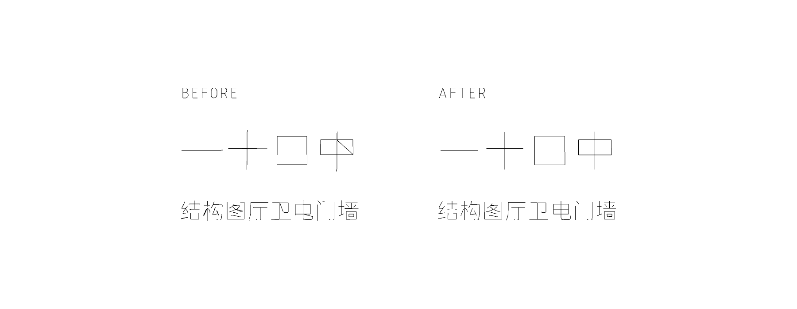

# SketchUp Stroke Text v0.3.0-preview

SketchUp Stroke Text 提供 SketchUp Ruby 单线文字绘制接口，并附带从开源 Noto Sans CJK SC 提取的试验性中文 LFF 字库。它适合探索 CAD 标注与绘图；**全字库尚未逐字人工校对，不应视为已经验证的标准工程字库**。

SketchUp Stroke Text is a Ruby interface for drawing single-line text in SketchUp, bundled with an experimental LFF font derived from Noto Sans CJK SC. It is a preview: the full character set has not been manually reviewed glyph by glyph.



同一段样本文字在 SketchUp 中：改进字库生成 484 条边、0 个面，原 penplot 单线字库生成 487 条边，原生 SimHei 平面文字生成 1,100 条边和 49 个面；数字仅适用于该样本。

## 特点 / Status

- 包含 GB 2312 一级 3,755 字、二级 3,008 字，以及基础字母、数字和部分符号；另有 `Φ`、`Ø`、`㎡`。共 7,145 个字形记录，其中 7,143 个非空，ASCII 与全角空格按字宽推进。原始 glyph 均先经源字体 Unicode cmap 验证。统计和字库哈希见 [full-summary.json](evidence/full-summary.json)。
- 标点覆盖：ASCII 标点 32 个、中文常用标点 40 个（`，。、；：？！“”‘’（）《》〈〉【】〔〕「」『』—…·～` 等）均已包含。本版补充了 19 个扩展字符：`⑳ ↔ ∂ ∇ ∅ ‐ 〜 ｟ æ Æ ø Å å ß ♡ ¢ £ ¡ ¿`。其中 `Æ`、`æ`、`ø`、`ß` 等拉丁扩展字母因字符本身含交叉结构，骨架化后段数较多，观感与既有 ASCII 字母一致，未做人工校正。`₽`（卢布符号）不在源字体 cmap 中，未包含。
- 骨架图在交点切分并共享节点；简化线按半像素间隔检查源墨迹。它不保证连续几何始终在墨迹中，也不保证所有笔画结构正确。**点状笔画处理**：骨架化后点会退化为 0.015 字体单位的极短段。SketchUp 对短于 0.001 英寸（0.0254 mm）的边不渲染，3.5 mm 字高下该点只有 0.005 mm，因此不可见。本版把 50 个符号字符中的**孤立点**沿原方向、以原中点为中心拉长到 0.3 单位，在 3.5 mm 字高下为 0.105 mm，随字高等比缩放。判定条件为：符号区字符 + 两点单段 + 长度 < 0.05 单位 + 两端点都不被其他路径共享。因此 `!` `?` `;` `i` `j` `¡` `¿` `¨` `…` `∴` `∷` 等已修复，而箭头尖端、`※` 中心交叉、汉字笔画等与其他路径相连的短段保持不变。
- **实心符号按空心轮廓绘制**：`■` `●` `◆` `▲` 是实心填充图形，单线字体无法表达填充，骨架化后坍缩为单个点。本版改用源字体中对应空心字符的轮廓（`□` `○` `◇` `△`），码位与字宽不变。这是单线字体的固有限制，不是可以修复的缺陷。
- SketchUp 2022 样本中，“一”1 条边、“十”交点连通、“口”为 4 边闭环、“中”9 边且没有跨框斜线。样本文字在 3.5 mm 和 100 mm 名义 em 下边数一致，无面。整套字体仍需进一步复核。
- v0.3 直接向调用方的 `Sketchup::Entities` 写入边，返回结果 Hash；原 v0.2 返回组的接口已变更。字库和历史运行记录见 [接口验收数据](evidence/entities-api-runtime.json)，该记录针对旧接口。
- 100 个未参与调参的汉字抽样见 [预览](evidence/strokes-holdout.png) 和 [结果](evidence/audit-holdout.json)。样本的 3,695 个线段按每 0.5 栅格像素取样，没有发现样点落在源墨迹外；该检查不是字形正确性证明。

简化时保留独立墨迹分量；个别骨架化后消失的墨点以短线表示。一次独立抽检发现“申”的竖笔被误剪：其十字交点分成两个紧邻的三叉节点，被原规则误判为框角。现当局部笔画宽度范围内还有其他高阶节点时保留末梢；现场候选样本中“申”恢复上下竖伸，口、中等对照字保持原有拓扑。对曾被剪尾的 2,090 个字重新筛查后，248 个字共保留 264 条原会被删的末梢；清单见 [repair-report.json](evidence/repair-report.json)。自动规则仍可能误删或保留不理想笔画，小字、复杂字、符号和模型尺度请在实际用途下检查。

## SketchUp

在 SketchUp Ruby 控制台加载本项目 `sketchup/sketchup_stroke_text.rb` 的完整路径，然后通过任意 `Sketchup::Entities` 容器调用。加载本身不会修改模型。需要 SketchUp 2022 或更新版本。调用直接向传入的实体集合写边并返回结果 Hash；调用方负责容器和事务。

```ruby
# Replace the path with the local project location.
load '/path/to/sketchup-stroke-text/sketchup/sketchup_stroke_text.rb'
model = Sketchup.active_model
model.start_operation('Stroke text', true)
begin
  group = model.active_entities.add_group # 如需分组，由调用方创建
  result = group.entities.add_stroke_text('建筑平面', height: 100.mm)
  p result[:missing]
  model.commit_operation
rescue Exception
  model.abort_operation
  raise
end
```

完整接口：

```ruby
entities.add_stroke_text(text, height: 10.mm, font: nil, origin: [0, 0, 0],
                         width_factor: 1.0, letter_spacing: 0.0,
                         line_spacing: nil, align: nil)
```

`entities` 可以是 `model.active_entities` 或已有组的 `group.entities`，`origin` 在该容器局部坐标中。返回 `{ edges:, missing:, lines: }`：`edges` 是本次新增的有效边，不包含碰巧复用的已有边；`missing` 是去重缺字数组；`lines` 是每行的纯坐标布局。不会内部建组或变换已有实体，调用方负责开启事务、持久化属性以及选择容器。

`font` 默认为随包字体，也可传 LFF 路径或 `LFFText::Font`；`height` 是 em 高度而非可见字高；`width_factor` 缩放横向字形，`letter_spacing` 是不随字高或宽度因子缩放的额外长度。`line_spacing` 默认使用字库行距，可传 SketchUp 长度；`align` 可选 `:left`、`:center`、`:right`，按可见边界对齐各行，默认 `nil` 保留原始基线与字形侧边距。缺字以方框表示。调用使用 `Entities#build`，不会生成面或与已有几何求交；端点相同的已有边可能被复用，不在返回的新增边中。极短段会合并或跳过以适应 SketchUp 容差。旧版本 SketchUp 不支持此直接写入接口。`# Advance` 是配套读取器的 LFF 注释扩展。

```ruby
# Draw inside an existing group; this uses that group's local coordinates.
result = existing_group.entities.add_stroke_text('标高', height: 10.mm,
                                                  origin: [0, 0, 0])
```

`sketchup/example.rb` 是可加载的完整示例；加载它会绘制文字。若其他扩展已提供同名方法，本项目保留原方法而不覆盖它。

## 重新生成 / Rebuild

源轮廓为 [NotoSansCJKsc-Regular.otf，固定提交 f8d15753](https://github.com/notofonts/noto-cjk/blob/f8d157532fbfaeda587e826d4cd5b21a49186f7c/Sans/OTF/SimplifiedChinese/NotoSansCJKsc-Regular.otf)，SHA-256 `2c76254f6fc379fddfce0a7e84fb5385bb135d3e399294f6eeb6680d0365b74b`。原始 OTF 不包含在本仓库中。

使用 Python 3.12，安装根目录 `requirements.txt` 中固定版本的 NumPy 和 Pillow；不要安装 scikit-image，以复用本次验证的骨架实现。进入 `tools/` 运行：

```sh
cd tools
python generate_sample.py --font /path/to/NotoSansCJKsc-Regular.otf --tag full --prune-cycle-tails --tolerance 1.92 --charset-file charset.txt --no-preview --checkpoint /path/to/checkpoint.json
python finalize_font.py --font /path/to/NotoSansCJKsc-Regular.otf
python generate_sample.py --font /path/to/NotoSansCJKsc-Regular.otf --tag holdout --prune-cycle-tails --tolerance 1.92 --charset-file holdout-100.txt
python audit_holdout.py --font /path/to/NotoSansCJKsc-Regular.otf
python test_junction_guard.py --font /path/to/NotoSansCJKsc-Regular.otf --lff ../fonts/hei-improved.lff
cd ..
ruby sketchup/test_font.rb
ruby sketchup/test_entities.rb
ruby sketchup/test_collision.rb
```

生成参数为 256px、1.92px 简化容差、em 为 1.3 倍源字体 em；各字不按包围盒缩放。LFF 统一使用 UTF-8 和 LF 换行，以保持跨平台文件哈希一致。生成的文件位于 `tools/fonts/`；如需替换默认字体，验证后将其复制到顶层 `fonts/`。使用时每 500 字保存检查点；输入、参数或生成器哈希发生变化时检查点不会被复用。本版使用 Python 3.12.14、NumPy 2.3.5、Pillow 13.0.0，不同版本可能改变栅格化或骨架结果。

## 许可证 / Licenses

| 内容 | 许可 |
| --- | --- |
| 字体文件与其 Noto Sans CJK 来源 | [SIL Open Font License 1.1](OFL-Noto-CJK.txt) |
| `tools/` 中的生成器和 penplot 代码 | [AGPL-3.0-or-later](tools/LICENSE-penplot.txt) |
| 独立编写的 `sketchup/` Ruby 读取器及示例 | [MIT](sketchup/LICENSE) |

penplot 代码取自 [固定提交 4a031218](https://github.com/jiangmuran/penplot/tree/4a031218cf52af8f9ae871fe74797146a19f1bf2)。字体许可与工具代码许可分别适用；请保留相应版权和许可声明。
